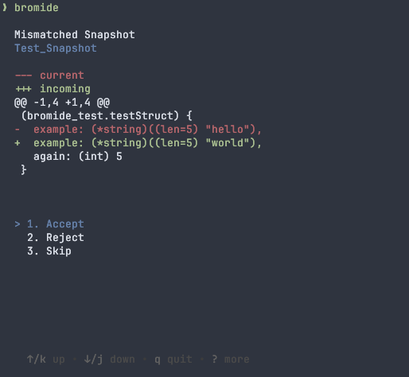

<div align="center">
<h1 align="center">bromide</h1>
 <strong>
  A snapshot testing library for go 📸
 </strong>
</div>

<br />

<div align="center">
 <br />
 
</div>


## Introduction

Bromide is a snapshot library for Go, designed to simplify managing snapshot tests.

With Bromide, you can easily capture test output and then review any differences against expected values.

## Usage

### 1. Write a Snapshot Test

Install the library:

```sh
go get github.com/cobbinma/bromide
```

Write a test that calls `bromide.Snapshot`:

```go
import github.com/cobbinma/bromide

func TestSomething(t *testing.T) {
    text := "world"
    something := testStruct{
      example: &text,
      again:   5,
    }

    bromide.Snapshot(t, something)
}
```

### 2. Run Your Tests

Run your tests as usual:

```sh
go test ./...
```

If the snapshot does not match, you will see output like:

```
--- FAIL: TestSomething (0.00s)
    bromide_test.go:24: snapshot mismatch
    bromide_test.go:24:
        --- current
        +++ incoming
        @@ -1,4 +1,4 @@
         (bromide_test.testStruct) {
        -  example: (*string)((len=5) "hello"),
        +  example: (*string)((len=5) "world"),
           again: (int) 5
         }

    bromide_test.go:24: to review and approve new snapshots, run `bromide`
FAIL
FAIL    github.com/cobbinma/bromide     0.211s
FAIL
```

### 3. Review and Approve Snapshot Changes

Install the Bromide CLI if you haven't already:

```sh
go install github.com/cobbinma/bromide/cmd/bromide@v0.0.2
```

Run the review tool to inspect and approve changed snapshots:

```sh
bromide
```

This will show you a UI to review, approve, or reject snapshot updates.



## See Also

* [cupaloy](https://github.com/bradleyjkemp/cupaloy)

## Thanks

* [cupaloy](https://github.com/bradleyjkemp/cupaloy)
* [insta](https://github.com/mitsuhiko/insta)
* [birdie](https://github.com/giacomocavalieri/birdie)
